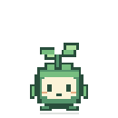
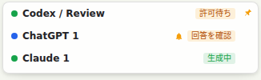

# Mori Desk

**ブラウザ AI の待ち時間を、キャラクターとセッション一覧で確認するデスクトップアプリ。**

ChatGPT / Claude の生成状態を自分で管理する Chrome 拡張機能から受け取り、
キャラクターの下にタブごとの行を表示します。明示的に CLI モードで起動すると、
clawd-on-desk の CLI 連携も同じ HUD で利用できます。

**現在は `0.1.0-preview.1` の開発プレビューです。** 実装とローカル自動テストは
用意していますが、Windows / macOS 実機、実際の Chrome への読み込み、
ChatGPT / Claude の本番画面、署名済みインストーラーは未検証です。
社員向け配布前に [検証状況](docs/verification-ja.md) の実機項目を確認してください。

## Windows ですぐ試す

準備するものは **Node.js 24.18.0 以降の 24.x、Git for Windows、Chrome** です。
BAT はこれらを自動インストールしません。

```powershell
git clone https://github.com/kaduiro/mori-desk.git
cd mori-desk
.\setup-windows.bat
```

フォルダー内の `setup-windows.bat` をダブルクリックしても実行できます。
初回は固定した上流ソースと依存関係を取得します。成功すると Mori Desk が起動します。

2 回目からは **`start-windows.bat`** を起動してください。
通常起動でソースの再取得や依存関係の再インストールは行いません。

詳しい手順とトラブル対応は [Windows 手順書](docs/windows-ja.md) にあります。

## Chrome を接続する

1. Mori Desk の「ブラウザ連携」画面で **「拡張機能のフォルダー」**を押します。
2. Chrome の `chrome://extensions` を開き、「デベロッパーモード」をオンにします。
3. 「パッケージ化されていない拡張機能を読み込む」で、手順 1 の
   **`.runtime/extensions/browser-bridge`** フォルダーを選びます。
4. Mori Desk の **「接続コードを作成」→「コピー」**を押します。
5. 拡張機能の設定画面に貼り付け、**「接続する」**を押します。コードは 2 分で失効します。
   設定画面は初回読み込み時、または拡張機能のアイコンを押すと開きます。
6. 既に開いていた ChatGPT / Claude のページを再読み込みし、普通のテキスト会話で試します。

API キーは不要です。アプリ、拡張機能、AI のタブは同じ PC で使います。
OS の保護された鍵保存を使えない場合、アプリは接続を受け付けず理由を表示します。

Chrome の組織ポリシーやローカルネットワーク関連の権限が接続を制限する場合は、
管理者の配布・許可手順で確認してください。ブラウザのセキュリティ機能を
無効化する手順は必要ありません。

## どう表示されるか

Mori の実際の描画と、合成セッションを使った HUD の表示確認です。
**いずれも Linux のテスト画面で、Windows の画面や実サービス接続の証明ではありません。**
実行時にはセッションの一覧がキャラクターの下に表示されます。





| 状況 | HUD の表示・動き |
|---|---|
| 生成を観測した | タブの行に「生成中」。Mori が動く |
| 生成終了の候補を観測した | 「回答を確認」と未確認通知。Mori が短く反応する |
| 停止操作を観測した | 「中断」 |
| 明示的なエラーを観測した | 「エラー」 |
| 観測が古い、切断した | 「状態を確認できません」。完了には変換しない |
| タブを閉じた | 「タブを閉じました」。未確認通知は保持する |
| HUD の行を押した | 対応するタブへ移動。成功した場合だけ、押した時点の通知を確認済みにする |

一つのタブが一つの行です。同じ会話を別タブで開くと別々に表示します。
表示はサービス名などのメタデータを使い、会話タイトルや回答文は出しません。
行が増えた場合は折りたたみ行からブラウザのセッション画面を開けます。

**この版はブラウザの「正常終了」を断定しません。** 停止ボタンが消えたことなどから
終了候補を見つけても `unverified`、日本語では「回答を確認」として知らせます。
従来の CLI ダッシュボードへのブラウザ行の追加は対象外で、統合先はキャラクター下の HUD と
新しいブラウザ連携画面です。

## CLI と併用する

**元の Clawd on Desk と、既に起動中のブラウザ用 Mori Desk を終了してから**
`start-cli-windows.bat` を起動します。必要な CLI の連携を Mori の設定画面で
明示的に有効にしてください。新規インストールでは Claude Code / Codex の連携も無効です。

この版では元アプリの設定を自動移行しません。両アプリで同じ CLI hook / runtime を
同時管理する使い方は対象外です。Mori は既存の生きている所有プロセスを検出した場合に
CLI runtime の上書きを止めます。

CLI からのアプリ自動起動はプレビューでは無効です。アプリを先に手動で起動します。
OS ログイン時の起動を設定した場合もブラウザ用モードになるため、CLI を使う日は
通常の Mori を終了して専用 BAT で起動してください。

## EXE を作る

Windows でセットアップ後に **`build-windows.bat`** を起動します。

```text
.runtime/dist/Mori-Desk-Setup-0.1.0-preview.1-x64.exe
```

これは **ビルド時の出力予定パス**であり、このリポジトリにビルド済み EXE は添付していません。
ビルドした Electron アプリはランタイムを含むため、その利用者に Node / Git は不要です。
拡張機能の初回導入とペアリングは別途必要です。

社員の Mac 用には Mac runner でのビルド、署名・公証、実機確認を別工程で行います。
このソース版のビルドスクリプトは GitHub Release に自動公開しません。

## ソースの構成

| 場所 | 内容 |
|---|---|
| `upstream.lock.json` | 利用する clawd-on-desk の完全な commit SHA |
| `patches/mori.patch` | 上流の既存ファイルに対する変更 |
| `overlay/src/` | ブラウザ接続、認証、保存、Mori の画面などの追加モジュール |
| `overlay/extensions/browser-bridge/` | 自社で管理できる拡張機能の全ソース |
| `overlay/themes/mori/` | オリジナルキャラクターのテーマ |
| `overlay/scripts/generate-mori-assets.js` | 画像・アイコンを生成する編集可能なソース |
| `scripts/` | 固定ソースの取得、組み立て、起動、ビルド補助 |
| `.runtime/` | セットアップで生成される実行環境。Git 管理外 |

コードは clawd-on-desk の派生版です。上流の画像類を含めず、固定したコードに
パッチと追加ソースを適用する方式にしています。元の作者・ライセンスは維持します。
Mori のキャラクター素材は独自のコードから生成します。

通常は `overlay/` と `patches/` を編集してから `npm.cmd run setup` で再構築します。
`.runtime/` を直接編集すると、次のセットアップで置き換わります。

## 開発用コマンド

```powershell
npm.cmd run setup
npm.cmd start
npm.cmd run start:cli
npm.cmd test
npm.cmd run verify:electron
npm.cmd run build:win:x64
```

`npm test` はこの派生版の browser / Mori テストを実行します。
上流の全テストが通ったことを意味しません。

## データと保守

拡張機能が送るのは生成状態、セッション識別子、会話パスなどのメタデータです。
入力、回答、ページタイトル、Cookie、API キー、HTML は送信しません。
通信先は同じ PC の `127.0.0.1:23333–23337` に限ります。
ペアリング鍵はデスクトップ側で Electron safeStorage、拡張側で同期しない
`chrome.storage.local` の trusted contexts に保存します。

拡張機能とアプリの自動更新は、このプレビューでは行いません。
上流コードの取得は固定 SHA、依存関係は lockfile で固定します。
所有者変更や依存関係の更新に対するレビューは引き続き必要です。

- [技術構成と変更箇所](docs/architecture-ja.md)
- [ブラウザ通信仕様](docs/browser-protocol-v1.md)
- [検証状況と社員配布までの工程](docs/verification-ja.md)
- [Windows の実行手順](docs/windows-ja.md)
- [変更・著作権・対応するソースの案内](MORI-NOTICE.md)
- [AGPL-3.0-only](LICENSE)

上流: [rullerzhou-afk/clawd-on-desk](https://github.com/rullerzhou-afk/clawd-on-desk)
（固定 commit `384a9322972c46d17122845bcc26e5b4b90e670c`）。
Mori のテーマ・生成素材には `overlay/themes/mori/LICENSE` の MIT License を適用します。
