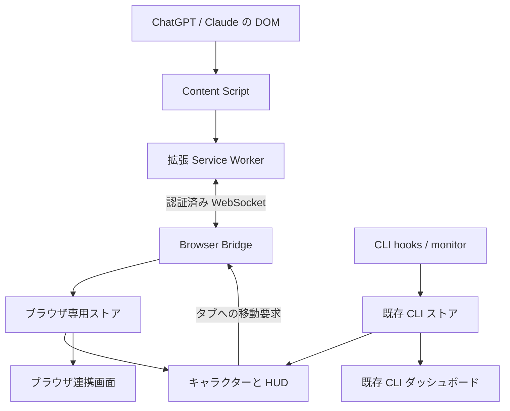

# Mori Desk の技術構成

## 1. 実装範囲

Mori Desk は clawd-on-desk のコードを固定 commit から取り込み、既存の
Electron ウィンドウと HUD を利用する派生版です。ブラウザの状態取得は新しい
拡張機能、保存と認証は新しい Electron main のモジュールが担当します。

新規モジュールは `overlay/`、既存ファイルの変更は `patches/mori.patch` にあります。
実行時にはそれらが `.runtime/` に組み立てられます。

## 2. ブラウザでの観測

Content Script は対象サービスのページ内で、停止ボタン、入力欄、回答枠などの
**要素の存在・可視性・属性**を観測します。MutationObserver で変化を拾い、
一定間隔の再観測で observer 対象の差し替えなどを補います。

生成状態の判定は本文を使わず、構造の観測で行います。表示用には、会話タイトルと
最新の送信済みユーザー依頼の冒頭を各160 UTF-16コード単位以内で取得します。
下書き・回答文・会話全文を収集せず、既存の文字列を短く表示します。
表示用データは検証済みのページと会話経路に結び付け、画面の切り替え時には古い会話の
データを引き継ぎません。サイト固有の状態観測は `adapters/chatgpt.js` と
`adapters/claude.js` に分離しています。

生成中を観測した後、停止ボタンなどが消え、入力欄と回答枠が 800 ms 以上確認できた
場合に終了候補を通知します。正常終了の確証ではないため、この版は
`completed` を生成せず、`unverified` / 「回答を確認」にします。

生成開始前から表示されていた過去の回答を開いただけでは終了通知を作りません。
音声、画像・動画生成、Deep Research は初期対応範囲外です。
拡張機能 0.1.1 では、ChatGPT の `/g/<scope>/c/<id>` 形式の会話も通常の
テキスト会話と同じ観測対象にします。デスクトップには `/c/<id>` へ正規化して送り、
プロジェクト名や GPT の名前に当たるパス部分は送りません。URL の受理と、実サービスの
画面を正しく認識できることは別で、アダプターが認識できない UI は観測不明を維持します。

## 3. 拡張機能の責任

Service Worker は Content Script の sender が対象ドメインの top frame かを確認し、
ブラウザ起動 ID、タブ ID、ページ ID、画面遷移の revision、ターン ID を管理します。
Content Script は認証鍵を持ちません。

終了・閉鎖イベントは local outbox に保存してから送信します。アプリが保存完了の
ACK を返すまで消しません。再接続時に同じイベントが届いても、アプリ側で重複を
識別できます。接続の ping と DOM 再観測は別で、ping が届いただけで古い状態を
「生成中」に戻すことはありません。

`storage`、`alarms`、`scripting` と、二つのサービスの host permissions を使用します。
同期ストレージ、全サイト権限、リモートコード、API キーの取得は使いません。
実際の Chrome のローカルネットワーク権限や組織ポリシーは実機で確認します。

拡張機能の「タブの監視を確認・復旧」は、許可したサービスの現在のタブにだけ
問い合わせ、ページ内の監視の応答、復旧結果、対応外の画面、生成中などの**件数**を表示します。
診断結果に本文・タイトル・URL は含めず、デスクトップにも送りません。
認証済み接続だけがある場合と、Content Script が実際に動いている場合を切り分けるための機能です。

拡張機能 0.1.6 は、応答しないページ内の監視を `chrome.scripting` で復旧します。
対象は既存の host permissions 内の対応ルートと最上位の文書だけで、同梱スクリプトを
拡張専用の隔離環境へ再配置します。現在の文書を確認し、画面遷移中の別会話に
復旧結果を紐付けません。監視を停止中・未ペアリング・保存に異常がある場合は実行せず、
読み込み中・休止中のタブにも無理に介入しません。同じタブへの同時実行と失敗後の
連続試行を抑え、1回の確認は最大20タブです。復旧はページを再読み込みせず、
入力・クリック・タブの前面化も行いません。監視の再開だけでは完了通知を作りません。

## 4. Electron 側の責任

`browser-bridge-server.js` が、既存ローカル HTTP サーバーの WebSocket upgrade に
`/browser/v1` を追加します。接続先は実際に bind できた `127.0.0.1` の
23333～23337 番ポートのいずれかです。

Origin、Host、ポート、アプリの instance、双方の nonce を検証し、HMAC で相互認証
します。鍵は Electron safeStorage で保護します。保護された保存先が使えないときに
平文保存へ切り替える機能はありません。WebSocket はローカル平文通信であり、
HMAC は認証であって内容全体の暗号化ではありません。

ブラウザ用モードでは従来の HTTP `/state` などに 404 を返します。従来 CLI hooks が
Mori を自分たちの受信先だと誤認しないためです。CLI モードでは従来経路を維持し、
Origin を持つ Web ページからの native hook 呼び出しを引き続き拒否します。

HUD の接続案内はセッションとは別の `moriBrowserStatus` メタデータです。
ブラウザ用モードでセッションが0件の場合だけ表示し、セッション数や未確認通知は増やしません。
接続準備中、Chrome 未登録、登録済みで未接続、接続済みで生成状態が未受信、接続不可を区別します。
設定の「ダッシュボード」はブラウザ用モードならブラウザ連携画面へ、CLI モードなら
既存の CLI ダッシュボードへ進みます。CLI のストアや通知先にブラウザ行を混ぜる変更はありません。

## 5. 状態と未確認通知を分ける

一つの行に、現在の生成状態と、過去のターンの未確認通知を別々に保存します。
「前の回答をまだ見ていないまま、次の質問を送る」場合でも未確認を失いません。

主な独立した軸は次のとおりです。

| 軸 | 値の例 | 意味 |
|---|---|---|
| phase | idle / running / settled | 現在のターンの進行 |
| outcome | unverified / interrupted / error | 終了した場合に観測できた内容 |
| observation | fresh / stale / closed / unsupported | その画面を今も観測できるか |
| receipt | 未確認 / 確認済み | 利用者への通知の確認状況 |

状態を JSON に保存してから終了イベントの ACK を返します。保存失敗時は ACK を
返さず、拡張機能に再送の機会を残します。原子的な置き換えと既知の正常なバックアップを
使いますが、ディスク故障や OS 異常に対する無損失を保証するものではありません。

HUD を押すと、ブラウザ起動・タブ・ページ・会話の識別子を含む移動要求を送ります。
拡張機能は移動前後に識別子を確認し、成功したときだけ応答します。アプリは
**クリック時に捕捉した通知番号まで**を確認済みにするため、その途中で新しい回答が
終了しても新しい未確認を消しません。

## 6. 既存 CLI と OS の境界

ブラウザ状態は既存 CLI reducer に投入しません。`mori-desktop-snapshot.js` が
キャラクター下の HUD 向けにだけ表示を統合します。従来ダッシュボード、recap、
LAN などの CLI snapshot の入力は維持します。外部通知機能は初期設定で無効です。

アプリ ID と userData、recap と quota の保存先を Mori 用に分けます。
ブラウザ用モードは shared CLI runtime や CLI 自動セットアップを使いません。
CLI モードは起動前・runtime 書き込み前に既存の所有プロセスを確認します。
競合アプリを後から同時に起動する使い方や、自動移行は未対応です。

Electron の JavaScript / HTML / CSS は共有できます。ただし最前面・透過ウィンドウ、
フォーカス、DPI、複数画面、safeStorage、署名、インストーラーには OS ごとの確認が
必要です。Windows でビルド・検証できても Mac の動作保証にはなりません。

### 会話名と履歴の扱い（0.1.3-preview.1）

`browser-session-store.js` が表示用の `conversationTitle` と `requestPreview` を検証・保存します。
保存時のタブ識別子と通知履歴は維持し、同じ会話を二つのタブで開いても統合しません。
現在の接続のブラウザ起動に属し、閉鎖されていない記録を `isCurrent` として表示し、
それ以外を `isHistory` として分けます。観測の鮮度とこの区分は別であり、現在のタブでも
再観測待ちの状態は引き続き不明です。再接続のpingだけで生成状態を復元しません。

手入力の表示名は同一プロファイル・サービス・正規化した会話IDをもとに再利用できます。
ID未確定の新しい会話には、別の記録の名前を推測して付けません。古い未確認通知は
元の記録に残し、履歴を開く操作だけでは確認済みにしません。

## 7. 社内保守へ向けた分離

上流のコード取得は完全な SHA に固定し、上流の自動更新・テーマダウンロード・
protocol 登録をプレビューでは停止しています。独自の Mori 素材だけを生成・同梱します。

正式配布では、組織が所有するリポジトリと拡張機能 ID、レビュー、署名、更新承認、
DOM adapter の保守、保存履歴の整理 UI を運用に含めます。所有者を自社にするだけで
依存関係や開発者アカウントに由来するリスクが消えるわけではありません。

実装上の定数や正確な schema は各モジュールと [通信仕様](browser-protocol-v1.md) を参照してください。
